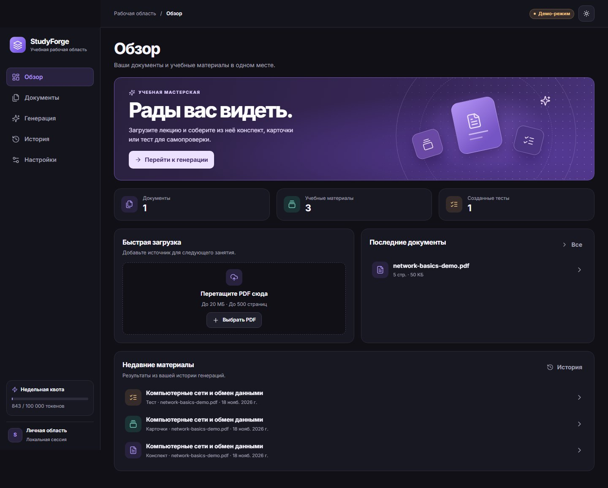
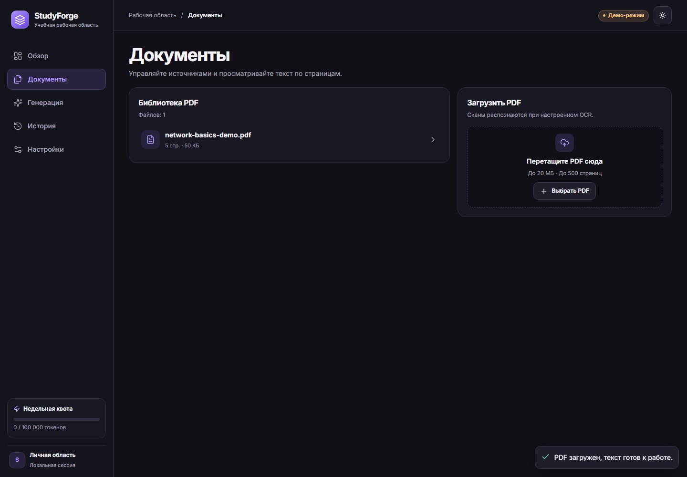
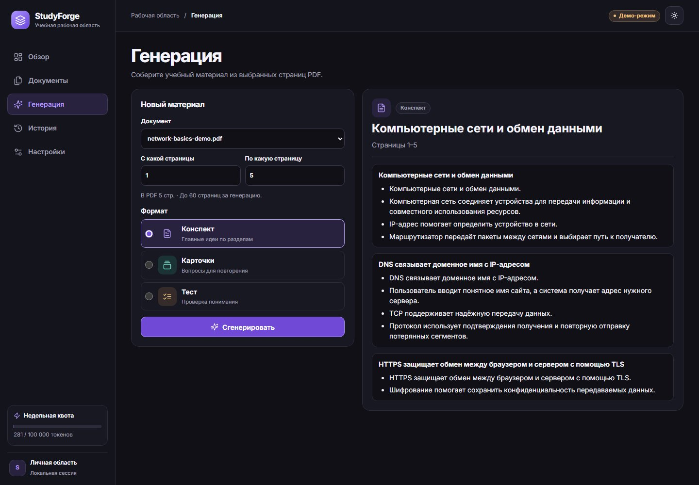
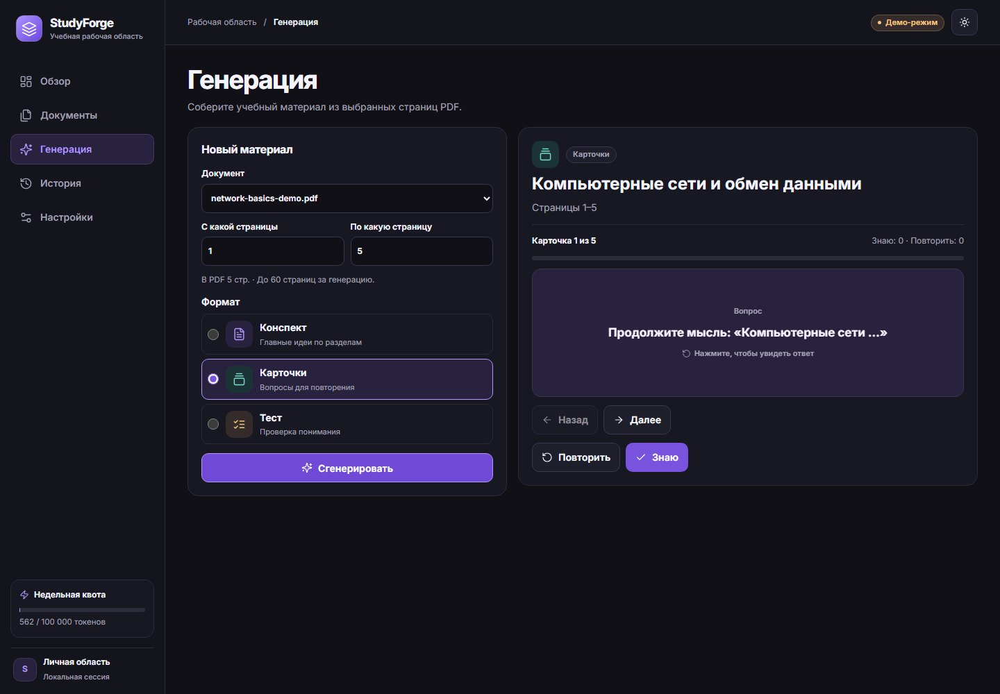
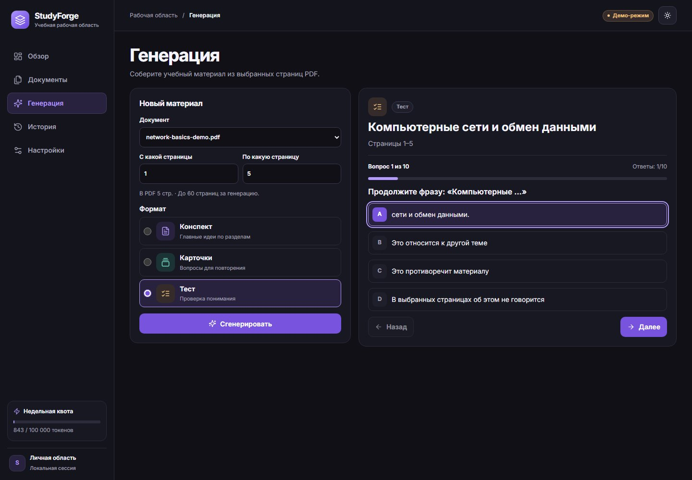

# StudyForge 2.1

A local study workspace that turns PDF pages into summaries, flashcards, and interactive quizzes. StudyForge combines multilingual OCR, server-side Gemini integration, and a browser interface with local document and material history.

Built as a Python/FastAPI portfolio project and a local demonstration. The interface is in Russian. The default **Mock Mode** works without an API key or external AI requests.



## Features

- **PDF processing:** upload or drag and drop a PDF, preview extracted text by page, select a page range, and delete a document with its generated materials.
- **Multilingual OCR:** recognize scanned pages in Kazakh, Russian, and English using local Tesseract models. Mixed PDFs retain page order and use OCR where the text layer is weak.
- **AI-assisted summaries:** optionally send selected excerpts to Gemini and validate structured responses before saving. An OpenAI-compatible adapter is also available.
- **Flashcards:** flip cards, navigate with keyboard controls, and mark cards for review during the current session.
- **Interactive quizzes:** shuffled answers retain their correct-answer identity; results include a score and answer review. Gemini quiz results can include explanations and source-page references.
- **Material history:** store documents, extracted text, summaries, cards, quizzes, and job state in SQLite. Cached results are scoped by document, page range, format, provider, and model.
- **Usage and cost tracking:** weekly token accounting, available Gemini token metadata, and configurable daily Gemini attempt/budget controls. Displayed costs use configured prices and are estimates, not provider invoices.

## Tech Stack

| Area | Technologies |
|---|---|
| Backend | Python 3.12, FastAPI, Uvicorn, Pydantic |
| Frontend | HTML, CSS, vanilla JavaScript, ES modules |
| AI integration | Google Gen AI SDK, optional OpenAI-compatible adapter, HTTPX |
| PDF and OCR | pypdf, pypdfium2/PDFium, tesserocr/Tesseract, Pillow |
| Storage | SQLite and local PDF files |
| Verification | pytest, Node.js built-in test runner, Playwright/Chromium |
| UI assets | Bundled Inter fonts and Lucide icons |

FastAPI serves the interface and API from the same origin. Generation jobs run in the application process with state recorded in SQLite. There is no separate frontend build step or JavaScript package installation.

## Screenshots

These are genuine captures of the running application using a synthetic educational PDF and local **Mock Mode**. They do not show live Gemini output or real user documents. JPEG images are optimized for repository viewing.

| View | Screenshot |
|---|---|
| Main workspace | [Dashboard](docs/screenshots/01-dashboard.jpg) |
| PDF library and upload | [Documents](docs/screenshots/02-documents.jpg) |
| Generated summary | [Summary](docs/screenshots/03-summary.jpg) |
| Flashcards | [Flashcards](docs/screenshots/04-flashcards.jpg) |
| Interactive quiz | [Quiz](docs/screenshots/05-quiz.jpg) |

### PDF library and upload



### Summary



### Flashcards



### Quiz



## Installation

Verified on **Windows x64 with Python 3.12**. Node.js is needed only for JavaScript tests; verification used Node.js 24. Other systems may require native Tesseract/Leptonica dependencies and have not been verified for this release.

Run in PowerShell:

```powershell
git clone https://github.com/kyo1age/StudyForge.git
Set-Location StudyForge
py -3.12 -m venv .venv
.\.venv\Scripts\python.exe -m pip install --upgrade pip==26.2.0
.\.venv\Scripts\python.exe -m pip install -r requirements.txt
if (!(Test-Path .env)) { Copy-Item .env.example .env }
```

Keep an existing `.env` and edit only the settings you need. If `py` is unavailable, use a Python 3.12 `python` executable. The pip upgrade addresses known installer issues; application versions remain pinned in `requirements.txt`.

### OCR language models

The Windows x64 tesserocr wheel used for verification includes Tesseract; a separate `tesseract.exe` is not required by this application. OCR also needs `kaz.traineddata`, `rus.traineddata`, and `eng.traineddata`.

Download the models from the official Tesseract repository without overwriting existing files:

```powershell
New-Item -ItemType Directory -Force .\data\tessdata | Out-Null
foreach ($lang in 'kaz', 'rus', 'eng') {
    $modelPath = ".\data\tessdata\$lang.traineddata"
    if (!(Test-Path $modelPath)) {
        Invoke-WebRequest "https://raw.githubusercontent.com/tesseract-ocr/tessdata_fast/main/$lang.traineddata" -OutFile $modelPath
    }
}
```

Alternatively, point `OCR_TESSDATA_DIR` at an existing compatible directory. Text-layer PDFs work without language models. A fully scanned PDF is rejected if OCR is unavailable; mixed documents can retain readable pages with a warning.

## Configuration

Settings load at startup from environment variables and the project-root `.env`. Existing environment variables take precedence. Restart after configuration changes. Credentials stay on the server; `.env` is ignored by Git.

| Variable | Purpose / default |
|---|---|
| `LLM_PROVIDER` | `mock` by default; optionally `gemini` or `openai` |
| `GEMINI_API_KEY` | Server-side key; empty in `.env.example` |
| `GEMINI_MODEL` | Repository default `gemini-3.5-flash-lite`; live access depends on the provider |
| `GEMINI_INPUT_PRICE_PER_1M` | Positive input price in USD per million tokens; required for Gemini |
| `GEMINI_OUTPUT_PRICE_PER_1M` | Positive output price in USD per million tokens; required for Gemini |
| `GEMINI_DAILY_REQUEST_LIMIT` | Global Gemini attempts per UTC day; default `30` |
| `GEMINI_DAILY_BUDGET_USD` | Global estimated Gemini budget per UTC day; default `2.00` |
| `OPENAI_API_KEY` | Server-side key for the optional OpenAI-compatible adapter |
| `OPENAI_BASE_URL` | Default `https://api.openai.com/v1` |
| `OPENAI_MODEL` | Default `gpt-4o-mini` for the optional adapter |
| `WEEKLY_TOKEN_LIMIT` | Per-client weekly allowance; default `100000` |
| `MAX_UPLOAD_MB` | PDF size limit; default `20` |
| `MAX_PAGES_PER_GENERATION` | Selected page-range limit; default `60` |
| `STUDYFORGE_DATA_DIR` | Database/upload root; defaults to project `data/` |
| `OCR_TESSDATA_DIR` | Defaults to the data root's `tessdata/` directory |
| `COOKIE_SECURE` | `false` for local HTTP; `true` requires HTTPS |

To enable Gemini, edit the existing server-side `.env`:

```dotenv
LLM_PROVIDER=gemini
GEMINI_API_KEY=your_key_here
GEMINI_MODEL=gemini-3.5-flash-lite
GEMINI_INPUT_PRICE_PER_1M=
GEMINI_OUTPUT_PRICE_PER_1M=
```

Replace the key placeholder and fill both prices using the [current provider pricing](https://ai.google.dev/gemini-api/docs/pricing) for your model and plan. Missing keys or invalid budget/model settings select Mock Mode with a configuration reason. An active provider failure becomes a failed job rather than a successful mock result.

Every Gemini attempt, including a retry, reserves estimated budget before transmission. Available token metadata settles it; conservative reservations remain after timeouts or missing metadata. A zero daily request/budget limit blocks calls. Controls depend on configured prices and are not a provider-enforced billing cap. Deleting documents or restarting does not clear the daily ledger. The OpenAI-compatible adapter does not use the Gemini-specific dollar-budget ledger.

## Running the Application

```powershell
.\.venv\Scripts\python.exe -m uvicorn app.main:app --host 127.0.0.1 --port 8001
```

Open [http://127.0.0.1:8001/](http://127.0.0.1:8001/). API documentation: [http://127.0.0.1:8001/docs](http://127.0.0.1:8001/docs). Use **one worker**.

For a separate demonstration library and no external AI calls, use a new PowerShell session:

```powershell
$env:LLM_PROVIDER = 'mock'
$env:STUDYFORGE_DATA_DIR = Join-Path $env:TEMP ('studyforge-demo-' + [guid]::NewGuid())
.\.venv\Scripts\python.exe -m uvicorn app.main:app --host 127.0.0.1 --port 8001
```

Close that terminal after the demo to avoid reusing its environment overrides. To migrate an existing library, stop its server, back up/copy the complete data directory including uploads, and run against the copy. Startup may migrate its schema. Existing anonymous libraries also require the original browser cookie.

## Tests

```powershell
.\.venv\Scripts\python.exe -m pip install -r requirements-dev.txt
$env:OCR_TESSDATA_DIR = (Resolve-Path .\data\tessdata).Path
.\.venv\Scripts\python.exe -m pytest -q
node --test tests/quiz.test.mjs
```

Release verification on 18 November 2026: **51 Python tests passed, 0 failed; 5 JavaScript tests passed, 0 failed.** Real multilingual OCR ran with all three models. Without the models, that OCR test is skipped. Python tests use temporary databases; provider tests use mocked network transport. The legacy `run_tests.py` executes 14 tests already included in pytest.

### Browser smoke test

Start a disposable Mock Mode server as above. In another terminal:

```powershell
.\.venv\Scripts\python.exe -m pip install playwright==1.65.2
.\.venv\Scripts\python.exe -m playwright install chromium --only-shell
.\.venv\Scripts\python.exe -m tests.browser_smoke --url http://127.0.0.1:8001
```

The Chromium workflow verifies uploads, invalid files, all material formats, caching, history/deletion, quiz scoring, privacy disclosure, literal rendering of document/AI HTML, network-error recovery, both themes, and four viewport widths. It checks for unexpected external requests from application pages. The release smoke test passed. No paid model calls were used.

## Privacy

- PDF text extraction and OCR run locally. In Mock Mode, generation also runs locally without sending text to an AI provider.
- With Gemini or the OpenAI-compatible adapter enabled, up to **24,000 characters** from selected pages are sent to the external provider. Gemini includes page numbers. The adapters do not upload the full PDF. Selected text can contain personal information.
- Provider processing/retention depends on the account plan and terms. Review the [Gemini API terms](https://ai.google.dev/terms), [Google privacy policy](https://policies.google.com/privacy), or the configured provider's terms before submitting sensitive content.
- PDFs are stored locally; extracted/OCR text, materials, jobs, and usage are stored in SQLite. The application does not encrypt them at rest.
- Document deletion removes its PDF, pages, materials, and jobs. Session records, weekly usage, and daily budgets remain. Deletion is not secure erasure of SQLite/WAL pages, backups, or provider submissions.
- OCR temporary folders are removed after success or handled failure; crashes can leave temporary files. API responses use `Cache-Control: no-store`.
- An HttpOnly/SameSite cookie identifies an anonymous library for up to five years. Possession grants access; losing it loses access to that library. Only the theme is stored in localStorage. Card marks and quiz attempts live in the open material rather than persistent progress records.
- Main UI assets are local. FastAPI `/docs` and `/redoc` use default CDN assets; ReDoc also loads Google Fonts.

## Limitations

- **Local demonstration scope:** this is not a production-ready multi-user cloud service. Cookies are not account authentication. General request, storage, and new-session quotas are absent. Do not expose it through `0.0.0.0`, a public tunnel, or a reverse proxy as a finished hosted product.
- Only `127.0.0.1`, `localhost`, and `[::1]` Hosts are accepted. Unsafe cross-origin API writes are rejected; CORS is not enabled. These measures support local use and do not replace authentication or abuse controls.
- Default limits: 20 MB per PDF, 500 pages, 2 million extracted characters, and 60 selected pages per generation. OCR allows two concurrent documents, up to 30 weak-text pages, 15 seconds per page and 120 seconds per document; rasters are bounded to approximately 8 MP and 4000 pixels on the longer side.
- Text-layer parsing runs in the API without a hard CPU/memory deadline. OCR subprocesses have timeouts but are not an OS sandbox and lack a hard memory quota. Process trusted documents locally; hostile-PDF handling needs stronger isolation/resource controls.
- Jobs run in-process. Restarting interrupts unfinished jobs and refunds recorded weekly reservations. Actual usage can exceed estimates and the weekly threshold.
- Mock Mode produces template-based demonstration material, not live Gemini output. AI answers can be inaccurate; verify facts and citations against the source.
- History records materials, not long-term quiz scores or card-review progress. Counters describe stored documents/materials.
- Live provider availability, quality, and billing were not tested for this release. Costs are estimates. Windows installation was verified; other platforms were not.

The earlier [AUDIT.md](AUDIT.md) records historical implementation work. See the [Russian freelance portfolio entry](docs/portfolio/freelance-kz-studyforge.md) for a project presentation.

## License

No application license has been selected or added. The decision remains with the repository owner. The project is presented as portfolio source without an open-source licensing claim.

Third-party asset licenses: [Inter](app/static/vendor/Inter-LICENSE.txt) and [Lucide](app/static/vendor/Lucide-LICENSE.txt).
